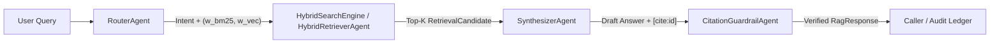

# Specification: Hybrid RAG Multi-Agent Core & Evaluation Harness

- **Bounded Context**: `cortex-rag-agent` — Domain Core (`src/domain/`)
- **Status**: Approved (SDD-First)
- **Python Version**: 3.12+ (Zero external dependencies in `src/domain/`)

---

## 1. Purpose & Architectural Invariants

`cortex-rag-agent` implements a deterministic, zero-dependency domain core for **Hybrid Retrieval-Augmented Generation (BM25 + Dense Vector Similarity + Reciprocal Rank Fusion)** orchestrated by a **Multi-Agent Pipeline** with strict **Citation & Grounding Guardrails** and a **Golden Dataset Evaluation Harness**.

### Core Domain Purity Invariants
1. **Zero Infrastructure Dependencies**: `src/domain/` uses only the Python 3.12 standard library (`dataclasses`, `enum`, `math`, `re`, `hashlib`, `time`, `typing`, `collections`).
2. **Immutable Value Objects & Entities**: All domain models use `@dataclass(frozen=True)` and self-validate invariants in `__post_init__`.
3. **Explicit Typed Domain Exceptions**: Every validation, retrieval, citation, grounding, or evaluation regression failure raises a dedicated subclass of `DomainError`. Silent truncation or ungrounded generation is strictly forbidden.

---

## 2. Domain Exceptions (`src/domain/exceptions.py`)

| Exception Class | Parent | Trigger Condition |
| :--- | :--- | :--- |
| `DomainError` | `Exception` | Base class for all domain-level invariant violations. |
| `InvalidQueryError` | `DomainError` | Query is empty, whitespace-only, or exceeds maximum length (2,000 chars), or `top_k <= 0`. |
| `InvalidDocumentError` | `DomainError` | `DocumentChunk` has empty `chunk_id`, `doc_id`, `title`, or `content`. |
| `EmptyRetrievalError` | `DomainError` | Corpus is empty or no candidate chunks can be retrieved for the query. |
| `InvalidCitationError` | `DomainError` | Synthesized answer cites `[cite:<chunk_id>]` where `<chunk_id>` is not present in the retrieved candidates. |
| `UngroundedClaimError` | `DomainError` | Synthesized answer contains no `[cite:<chunk_id>]` markers, or its grounding `faithfulness_score` falls below `min_faithfulness` (default `0.65`). |
| `EvalRegressionError` | `DomainError` | Evaluation suite aggregate metrics fall below quality gate thresholds when `enforce_gate=True`. |

---

## 3. Domain Entities & Value Objects (`src/domain/entities.py`)

### 3.1 `QueryIntent(str, Enum)`
- `LEXICAL_EXACT = "LEXICAL_EXACT"`: Queries containing error codes, standard identifiers, CLI flags, exact version numbers, or technical tokens (`err-409`, `aga-8`, `rfc-9457`).
- `SEMANTIC_CONCEPTUAL = "SEMANTIC_CONCEPTUAL"`: Conceptual, architectural, or explanatory queries (`how`, `why`, `architecture`, `explain`, `design`, `concept`).
- `HYBRID_ANALYTICAL = "HYBRID_ANALYTICAL"`: Multi-faceted technical queries requiring balanced lexical and semantic retrieval.

### 3.2 `DocumentChunk`
- `chunk_id: str` (non-empty)
- `doc_id: str` (non-empty)
- `title: str` (non-empty)
- `section: str` (defaults to `"general"` if empty, or validated string)
- `content: str` (non-empty)
- `tags: tuple[str, ...] = ()`
- `embedding: tuple[float, ...] = ()`
- Validates `chunk_id`, `doc_id`, `title`, and `content` are non-empty strings after stripping; raises `InvalidDocumentError` otherwise.

### 3.3 `RetrievalCandidate`
- `chunk: DocumentChunk`
- `bm25_score: float`
- `vector_score: float`
- `bm25_rank: int` (1-based rank)
- `vector_rank: int` (1-based rank)
- `rrf_score: float`

### 3.4 `Citation`
- `chunk_id: str`
- `doc_id: str`
- `title: str`
- `section: str`
- `excerpt: str`
- `rrf_score: float`

### 3.5 `AgentStepTrace`
- `agent_name: str`
- `action: str`
- `detail: str`
- `duration_ms: float`

### 3.6 `RagResponse`
- `query: str`
- `intent: QueryIntent`
- `answer: str`
- `citations: tuple[Citation, ...]`
- `candidates: tuple[RetrievalCandidate, ...]`
- `traces: tuple[AgentStepTrace, ...]`
- `faithfulness_score: float`
- `total_latency_ms: float`

### 3.7 Evaluation Entities (`EvalCase`, `EvalCaseResult`, `EvalSuiteReport`)
- `EvalCase`: `case_id: str`, `query: str`, `expected_chunk_ids: tuple[str, ...]`, `expected_keywords: tuple[str, ...]`
- `EvalCaseResult`: `case_id: str`, `query: str`, `intent: QueryIntent`, `faithfulness: float`, `citation_precision: float`, `context_recall: float`, `keyword_hit_rate: float`, `latency_ms: float`, `passed: bool`
- `EvalSuiteReport`: `run_id: str`, `total_cases: int`, `passed_cases: int`, `avg_faithfulness: float`, `avg_citation_precision: float`, `avg_context_recall: float`, `avg_latency_ms: float`, `results: tuple[EvalCaseResult, ...]`, `passed_gate: bool`

---

## 4. Hybrid Retrieval Mathematical Model (`src/domain/retrieval.py`)

### 4.1 Technical Tokenizer (`tokenize`)
Extracts lowercased alphanumeric and hyphen/underscore technical tokens (`[a-z0-9]+(?:[-_][a-z0-9]+)*`), preserving compound tokens like `err-409`, `aga-8`, `sha-256`, alongside sub-tokens so both exact compound matches and component terms contribute to scoring.

### 4.2 Okapi BM25 (`BM25Scorer`)
With parameters $k_1 = 1.5$ and $b = 0.75$:
$$\text{IDF}(t) = \ln\left(1 + \frac{N - df(t) + 0.5}{df(t) + 0.5}\right)$$
$$\text{BM25}(d, Q) = \sum_{t \in Q} \text{IDF}(t) \cdot \frac{tf(t, d) \cdot (k_1 + 1)}{tf(t, d) + k_1 \cdot \left(1 - b + b \cdot \frac{|d|}{\text{avgdl}}\right)}$$
Document tokens include title, section, tags, and content tokens (with title/tags weighted naturally via inclusion).

### 4.3 Deterministic Dense Hash Embedding (`compute_deterministic_embedding`)
Produces a $D=64$ dimensional L2-normalized unit vector $\hat{v} \in \mathbb{R}^{64}$:
- Extracts normalized tokens, token stems/prefixes, and character 3-grams/4-grams.
- Uses SHA-256 / BLAKE2s deterministic feature hashing into 64 buckets with signed projections ($\pm w$).
- Normalizes by Euclidean norm $\|\vec{v}\|_2$ so $\text{cosine\_similarity}(\vec{a}, \vec{b}) = \vec{a} \cdot \vec{b} \in [-1.0, 1.0]$.

### 4.4 Weighted Reciprocal Rank Fusion (`HybridSearchEngine`)
Combines BM25 ranking ($\text{rank}_{\text{bm25}}(d) \ge 1$) and Vector Cosine Similarity ranking ($\text{rank}_{\text{vec}}(d) \ge 1$) with $k = 60$:
$$\text{RRF}(d) = \frac{w_{\text{bm25}}}{k + \text{rank}_{\text{bm25}}(d)} + \frac{w_{\text{vec}}}{k + \text{rank}_{\text{vec}}(d)}$$

---

## 5. Multi-Agent Pipeline (`src/domain/agents.py`)

1. **`RouterAgent`**:
   - Validates query (`InvalidQueryError` if empty or $> 2000$ chars).
   - Classifies intent:
     - `LEXICAL_EXACT`: `bm25_weight = 0.75`, `vector_weight = 0.25`
     - `SEMANTIC_CONCEPTUAL`: `bm25_weight = 0.35`, `vector_weight = 0.65`
     - `HYBRID_ANALYTICAL`: `bm25_weight = 0.50`, `vector_weight = 0.50`
2. **`HybridRetrieverAgent` / `HybridSearchEngine`**:
   - Retrieves top-$k$ `RetrievalCandidate` items using BM25 + Vector + Weighted RRF.
3. **`SynthesizerAgent`**:
   - Selects relevant sentences/facts from top candidates and constructs a coherent technical synthesis where every factual claim carries an inline `[cite:<chunk_id>]` marker.
4. **`CitationGuardrailAgent`**:
   - Parses all `[cite:<chunk_id>]` markers from the synthesized answer.
   - Raises `UngroundedClaimError` if no citations exist.
   - Raises `InvalidCitationError` if any cited `chunk_id` is not in the retrieved candidate set.
   - Computes `faithfulness_score` ($[0.0, 1.0]$) as the content-token grounding overlap between each claim/sentence in the answer and the cited chunk(s).
   - Raises `UngroundedClaimError` if `faithfulness_score < min_faithfulness` (default `0.65`).
5. **`MultiAgentRagPipeline`**:
   - Orchestrates all four stages, measures per-agent latency in `AgentStepTrace`, constructs `Citation` objects, and returns an immutable `RagResponse`.

---

## 6. Evaluation Harness (`src/domain/eval_harness.py`)

`RagEvalHarness` evaluates a sequence of `EvalCase` items against a corpus using `MultiAgentRagPipeline`:
- **`faithfulness`**: Grounding score computed by `CitationGuardrailAgent`.
- **`citation_precision`**: Fraction of cited `chunk_id`s in the response that match `expected_chunk_ids` (or remain relevant to retrieved top expected chunks).
- **`context_recall`**: Fraction of `expected_chunk_ids` retrieved within the top-$k$ candidates.
- **`keyword_hit_rate`**: Fraction of `expected_keywords` present in the grounded answer.
- **Quality Gate**: Checks `avg_faithfulness >= min_faithfulness` (default `0.75`), `avg_context_recall >= min_context_recall` (default `0.80`), and `avg_citation_precision >= min_citation_precision` (default `0.70`). Raises `EvalRegressionError` when `enforce_gate=True` and the gate fails.

---

## 7. Repository Protocols (`src/domain/repositories.py`)

- `ChunkRepositoryProtocol`:
  - `list_chunks() -> Sequence[DocumentChunk]`
  - `upsert_chunk(chunk: DocumentChunk) -> None`
- `LedgerRepositoryProtocol`:
  - `append_query_audit(response: RagResponse) -> str`
  - `append_eval_report(report: EvalSuiteReport) -> None`
  - `list_eval_reports() -> list[dict]`
