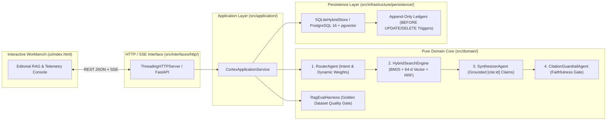

# Cortex RAG Agent — Multi-Agent Hybrid Retrieval, Citation Guardrails & Eval Harness

[](https://www.python.org/)
[](./.specs/01-domain/hybrid-rag-multiagent.spec.md)
[](./docs/adr/001-hybrid-rag-bm25-vector-rrf.md)

**Cortex RAG Agent** is a production-grade **Multi-Agent Hybrid Retrieval-Augmented Generation (RAG)** platform engineered under **Spec-Driven Development (SDD)**, **Clean Architecture**, and **Domain-Driven Design (DDD)**. It combines **Okapi BM25 lexical scoring**, **64-dimensional L2-normalized dense vector similarity (`pgvector`)**, and **intent-weighted Reciprocal Rank Fusion (RRF)** with deterministic **Citation Guardrails** and **database-enforced append-only audit & evaluation ledgers**.

---

## 1. Architecture Overview



### Key Engineering Capabilities
- **Dynamic Intent-Routed Hybrid RRF (`src/domain/retrieval.py`, `src/domain/agents.py`)**:
  - `RouterAgent` classifies queries into `LEXICAL_EXACT` ($w_{\text{bm25}}=0.75, w_{\text{vec}}=0.25$), `SEMANTIC_CONCEPTUAL` ($0.35, 0.65$), or `HYBRID_ANALYTICAL` ($0.50, 0.50$).
  - `HybridSearchEngine` fuses Okapi BM25 ($k_1=1.5, b=0.75$) and 64-d L2-normalized cosine similarity via Reciprocal Rank Fusion ($k=60$).
- **Strict Citation & Grounding Guardrails (`CitationGuardrailAgent`)**:
  - Verifies every inline `[cite:<chunk_id>]` reference against retrieved candidates (`InvalidCitationError` $\rightarrow$ `HTTP 422`) and enforces token/segment grounding faithfulness $\ge 0.65$ (`UngroundedClaimError` $\rightarrow$ `HTTP 422`).
- **Database-Enforced Append-Only Ledgers (`src/infrastructure/persistence/sqlite_store.py`, `migrations/001_init_pgvector_hybrid.sql`)**:
  - Every query execution (`query_audit_log`) and evaluation run (`eval_runs_ledger`) is protected by `BEFORE UPDATE` and `BEFORE DELETE` SQL triggers raising `APPEND_ONLY_LEDGER_VIOLATION`.
- **Zero-Dependency Native Python 3.12 Runtime**:
  - Runs out-of-the-box using only the Python 3.12 standard library (`sqlite3`, `http.server`, `unittest`) with optional `FastAPI` + `pgvector` container deployment.

---

## 2. API Endpoints (`/api/v1/*`)

| Method | Path | Description | Success | Error Codes |
| :--- | :--- | :--- | :--- | :--- |
| `GET` | `/` or `/ui` | Interactive Hybrid RAG & Eval Workbench (`ui/index.html`) | `200 OK` | — |
| `GET` | `/api/v1/health` | Service readiness, corpus size, and ledger counts | `200 OK` | `500` |
| `GET` | `/api/v1/chunks` | List indexed knowledge base chunks and metadata | `200 OK` | `500` |
| `POST` | `/api/v1/documents/ingest` | Validate and upsert a `DocumentChunk` with 64-d embedding | `200 OK` | `400` (`InvalidDocumentError`) |
| `POST` | `/api/v1/rag/query` | Execute Multi-Agent Hybrid RAG pipeline + append audit | `200 OK` | `400` (`InvalidQueryError`), `422` (`EmptyRetrievalError`, `InvalidCitationError`, `UngroundedClaimError`) |
| `POST` / `GET` | `/api/v1/rag/stream` | Stream ordered SSE events (`trace`, `token`, `citations`, `done`) | `200 OK` | `400`, `422` |
| `POST` | `/api/v1/evals/run` | Execute Golden Dataset Evaluation Suite (5 cases) + gate | `200 OK` | `400`, `422` (`EvalRegressionError`) |
| `GET` | `/api/v1/evals/ledger` | List immutable evaluation suite runs from append-only ledger | `200 OK` | `500` |
| `GET` | `/api/v1/audit/queries` | List immutable query audit records from append-only ledger | `200 OK` | `500` |

---

## 3. Quickstart (1-Command Run)

### Option A: Native Python 3.12 (Zero External Dependencies)

```bash
# Start the HTTP + SSE server and interactive UI workbench on http://127.0.0.1:8090
python -m src.interfaces.http.server
```

Then open **http://127.0.0.1:8090** in your browser (or open `ui/index.html` directly for standalone local execution).

### Option B: Docker & PostgreSQL 16 + `pgvector`

```bash
docker compose up --build
```

### Run Test Suite & Golden Evaluation Gate

```bash
python -m unittest discover -s tests -v
```

---

## 4. Repository Structure & Specifications

- `.specs/01-domain/hybrid-rag-multiagent.spec.md` — Domain entities, BM25/Vector/RRF math, and Multi-Agent invariants.
- `.specs/02-data/hybrid-store-and-append-only-ledger.spec.md` — SQLite & PostgreSQL `pgvector` schema and append-only triggers.
- `.specs/03-integration/http-sse-api-contracts.spec.md` — End-to-end REST/SSE DTO contracts and HTTP error mapping.
- `docs/adr/001-hybrid-rag-bm25-vector-rrf.md` — ADR for Dynamic Intent-Weighted Hybrid RRF.
- `docs/adr/002-citation-guardrail-and-append-only-eval-ledger.md` — ADR for Citation Guardrails & Immutable Ledgers.
